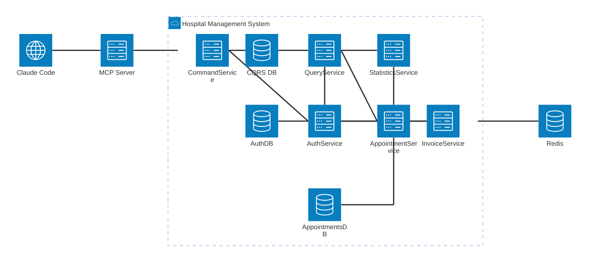

# Hospital Management System

[](https://github.com/jankovicdanilo/HospitalManagement/actions/workflows/ci.yml)

A backend REST API for managing hospital operations, built with .NET 8 and structured
as a set of microservices handling authentication, core domain data, and appointment
scheduling independently.

## Tech stack

- **Runtime**: .NET 8, ASP.NET Core Web API
- **ORM**: Entity Framework Core 8 with SQL Server
- **Auth**: JWT Bearer via `Microsoft.AspNetCore.Authentication.JwtBearer`
- **Mapping**: AutoMapper
- **Validation**: FluentValidation
- **Logging**: NLog
- **Caching**: Redis (statistics cache, token revocation list)
- **Resilience**: Polly (retry, circuit breaker, timeout)
- **AI integration**: Model Context Protocol (MCP) server
- **Containerisation**: Docker, Docker Compose
- **Orchestration**: Kubernetes, Helm
- **Testing**: NUnit, Moq
- **Documentation**: Swagger / Swashbuckle

## Architecture

This system is built as a set of microservices, each owning its own database and
communicating over HTTP.



### Services

**Auth Service** (`HospitalManagement.Auth`) handles all authentication concerns:
user registration, login, role assignment, and JWT token issuance, for both users and
service accounts. It is the only service that generates tokens. All other services
validate incoming tokens using the same shared signing key but never generate them.

**Command Service** (`HospitalManagement.CommandService`) is the write side of the
core domain. It owns Doctor, DoctorSchedule, Patient, and Procedure data in the CQRS
database and publishes changes to RabbitMQ.

**Query Service** (`HospitalManagement.QueryService`) is the read side of the core
domain. It serves Doctor, DoctorSchedule, Patient, and Procedure data from the CQRS
database and is the source other services call to look these up.

**Appointment Service** (`HospitalManagement.Appointments`) owns everything
appointment-related: Appointment, AppointmentProcedure, Treatment, and the discount
calculator. It has its own database and calls the Query Service over HTTP to validate
and look up doctors, patients, and schedules. Procedure name and price are
snapshotted onto appointment records at creation time, so later catalog changes do not
alter past appointments. It also exposes `GET /api/appointment/stats-data`, a flat
list of appointments with discounted totals used by the Statistics Service.

**Invoice Service** (`HospitalManagement.InvoiceService`) generates PDF and DOCX
invoices (English or Montenegrin) for completed appointments. It has no database and
fetches appointment data from the Appointment Service.

**Statistics Service** (`HospitalManagement.Statistics`) provides read-only aggregates
for the statistics dashboard: doctor load and revenue, procedure revenue, and patient
statistics. It has no database; it aggregates data from the Appointment and Query
services and caches results in Redis for 5 minutes. Downstream calls use Polly
(retry, circuit breaker, timeout). All endpoints take `from` and `to` dates.

**MCP Server** (`HospitalManagement.Mcp`, .NET 10) lets an AI assistant such as Claude
Code work with hospital data through the Model Context Protocol. It runs locally and is
started by the AI client over stdio, so it is not a deployed service. Its tools cover
doctors, patients, doctor schedules, free slots, and appointments: searching, reading,
creating, and deleting. Delete tools require an explicit confirmation. It calls the
Command, Query, and Appointment services over HTTP with a service token (role `Mcp`)
kept in its user secrets, never a user password. An admin issues the token through
Auth; it expires and can be revoked at any time. The `Mcp` role cannot use statistics,
invoices, or user management.

### Roles and permissions

Every user has exactly one role. The backend enforces the rules; the frontend only
mirrors them.

| Role        | What they do                                                                                                                         |
| ----------- | ------------------------------------------------------------------------------------------------------------------------------------ |
| **Admin**   | Full access, including user accounts and service tokens                                                                              |
| **Manager** | Runs the clinic's records: patients, doctors, schedules, and procedures. Sees statistics and invoices. Has no access to appointments |
| **Doctor**  | Works with their own appointments and patients, and can register new patients                                                        |
| **Mcp**     | A service role used only by the MCP server. It is never a login                                                                      |

| What                                                                                     | Admin | Manager | Doctor                |
| ---------------------------------------------------------------------------------------- | ----- | ------- | --------------------- |
| View doctors, schedules, patients, and procedures                                        | Yes   | Yes     | Yes                   |
| Add, edit, and delete patients                                                           | Yes   | Yes     | Yes                   |
| Add, edit, and delete doctors, schedules, and procedures                                 | Yes   | Yes     | No                    |
| Create, view, change, and delete appointments, including their procedures and treatments | Yes   | No      | Own appointments only |
| View a patient's history and AI summary                                                  | Yes   | No      | Own patients only     |
| View statistics and download invoices                                                    | Yes   | Yes     | No                    |
| Manage user accounts and service tokens                                                  | Yes   | No      | No                    |

**What "own" means for a doctor**

- An appointment is theirs when they are its doctor.
- A patient is theirs when they have at least one appointment with that patient, in any status.
- They can still find and register any patient, so they can book a first visit.
- Their appointment list only ever contains their own appointments, whatever filter is sent.
- They can create or edit an appointment only with themselves as the doctor, and look up free slots only for themselves.

**When a request is refused**

The service answers `403` with the same body as other errors, `{ "errorCode": "...", "message": "..." }`.
For example, `NOT_YOUR_APPOINTMENT` means a doctor touched another doctor's appointment.
A `401` still means the user is not logged in, or the token expired or was revoked.

**Creating users** (admin only) with `POST /api/auth/register`:

```json
{
  "username": "doctor6",
  "email": "doctor6@hospital.com",
  "password": "...",
  "role": "Doctor",
  "doctorId": 6
}
```

- `doctorId` is required for `Doctor` and not allowed for the other roles. It must be the id of an existing doctor; Auth does not check it.
- A role change applies after the next login, because the role is stored in the token.

**Redis requirement**

Every service that accepts service tokens needs Redis (`Redis:ConnectionString`). Tokens
with a `jti` are checked against the revocation list, and a service that cannot reach
Redis rejects them. Login tokens have no `jti` and are not affected.

### Shared library

`HospitalManagement.Shared` is a class library referenced by all services. It contains
shared primitives (`Result<T>`, `PagedResult<T>`, `BaseController`), the role names and
authorization policies, the token-forwarding HTTP handler, and shared DTOs and enums
such as `AppointmentStatus`. It has no runtime dependency on any service and is not
deployed independently.

## Deploy to Kubernetes

1. Build the images (once per change): `docker build -t hospitalmanagement-<service>:<tag> -f HospitalManagement.<Project>/Dockerfile .`
2. Create the secret: `.\hms-chart\scripts\create-secrets.ps1`
3. Install: `helm upgrade --install hms .\hms-chart -n hms-dev`
4. Check: `kubectl get pods -n hms-dev`
